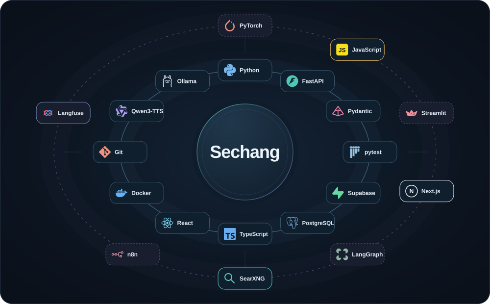

# 👋 Sechang

LLM 기능을 웹 서비스에 연결합니다.

Python/FastAPI 기반 백엔드와 AI 모델 연동을 중심으로 프로젝트를 만듭니다. 기능 구현과 함께 인증, 데이터 접근 제어, 예외 처리와 테스트를 다룹니다.

<!-- Animated, self-contained technology orbit. Full accessible toolkit is below. -->

  

## 🧩 What I build

| 영역 | 프로젝트에서 다룬 작업 |
| --- | --- |
| ⚙️ Backend | FastAPI API, Pydantic 입력 검증, 비동기 작업 처리, 상태 조회와 임시 파일 정리 |
| 🎙️ Speech & LLM | STT 작업 흐름, VAD 연동, TTS 스트리밍과 브라우저 재생, 로컬 LLM 연동 |
| 🔐 Auth & Data | Supabase 인증, JWT 검증, SQL 마이그레이션, RLS와 비공개 Storage 접근 제어 |
| 🖥️ Frontend & Integration | Next.js·React, JavaScript·TypeScript, CSS·SVG 인터랙션, MCP 도구와 HTTP 인터페이스 |
| 🧪 Quality & Delivery | pytest 테스트, 입력·출력 스키마 검증, Langfuse 관측, Docker/Compose 실행과 배포 확인 |

## 🧰 Toolkit

**프로젝트 구현·연동에 사용**

- Backend: Python · FastAPI · Pydantic · pytest
- Data: Supabase · PostgreSQL/SQL
- Frontend: JavaScript · TypeScript · Next.js · React · CSS · SVG · Web Audio API
- AI & Tools: STT/TTS · Silero VAD · Qwen3-TTS · Ollama · OpenAI API · MCP/FastMCP · SearXNG
- Observability: Langfuse
- Workflow: Git · GitHub · Docker · Docker Compose · Cloud Run · Vercel

**모델·데모 실습**

- PyTorch 기반 MNIST CNN 분류, 회귀 예측, Streamlit 데모를 실습했습니다
- NumPy를 데이터·오디오 처리에 사용했고, pandas · OpenCV · TensorFlow는 강의와 실습에서 다뤘습니다

**추가 실습·탐색**

- LangGraph 기반 에이전트 흐름 · RAG/PGVector 검색 · n8n 자동화

## 🛠️ How I work

- 요구사항과 API 계약을 먼저 정리하고, 작업을 PR 단위로 나눕니다
- Codex 등 AI 코딩 도구를 활용하며, 변경 내용과 리뷰 의견, 테스트 결과를 확인합니다
- 구현한 기능, 실제로 검증한 범위, 남은 한계를 구분해 기록합니다

<picture>
  <source media="(prefers-color-scheme: dark)" srcset="https://raw.githubusercontent.com/sechang405-maker/sechang405-maker/output/caterpillar-dark.svg" />
  <source media="(prefers-color-scheme: light)" srcset="https://raw.githubusercontent.com/sechang405-maker/sechang405-maker/output/caterpillar.svg" />
  
</picture>

## 📬 Contact

[sechang.405@gmail.com](mailto:sechang.405@gmail.com)
